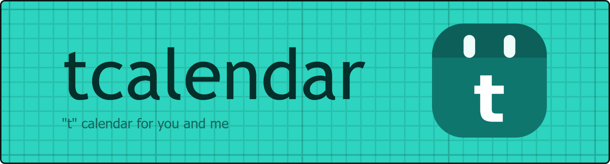

[](./tcalendar-banner.png)

TCalendar es un calendario compartido para grupos pequeños: equipos, cursos, familias y clubes. Se entra con usuario y contraseña, se crea un grupo, se invita a otras personas por nombre de usuario o enlace, y todos ven las mismas fechas.


[](#empezar)
[](#empezar)
[](#empezar)

Sin correo electrónico: el usuario se elige al registrarse y lo administra quien tenga acceso de administrador.

## Qué podés hacer

- **Entrar y recuperar el acceso.** Usuario y contraseña de 6 a 64 caracteres. El usuario no distingue mayúsculas; después de 5 intentos fallidos la cuenta queda bloqueada 15 minutos.
- **Organizar grupos.** Crearlos desde el panel, invitar miembros por nombre de usuario o con un enlace compartible, y elegir el sello que identifica a cada grupo.
- **Cargar fechas.** Crear eventos tocando un día, editarlos desde el detalle y moverlos de fecha. La interfaz clásica también permite arrastrarlos.
- **Poner todos de acuerdo.** Cada grupo tiene su agenda y sus miembros visibles, con el creador marcado.
- **Llevar el calendario a otra parte.** Exportar cada grupo como `.ics` para Google, Apple u Outlook.
- **Ajustar la cuenta.** Cambiar la contraseña, elegir una de 8 fotos de perfil y activar recordatorios push. Los administradores pueden restablecer contraseñas desde la propia interfaz.
- **Elegir el aspecto.** Tema claro, oscuro o del sistema, 6 paletas sin violeta y 3 fondos en la interfaz alterna.

## Dos interfaces, una sola API

Las dos carpetas web apuntan al mismo backend y comparten cuentas, grupos y eventos.

| Carpeta | Para qué sirve |
| --- | --- |
| `frontend/` | Interfaz original con FullCalendar: vista mensual, semanal y diaria, con arrastre de eventos. |
| `frontend-alt/` | Interfaz de agenda con línea de tiempo, "Hoy" marcado, lo próximo agrupado y vista Mes a un toque. Incluye las 8 fotos de perfil, los sellos de grupo, 6 paletas y fondos configurables. No arrastra eventos: la fecha se cambia desde **Editar**. |

En Vercel, publicá `frontend-alt/` como *Root Directory* y definí `VITE_API_URL` apuntando a tu backend.

## Empezar

Necesitás Node.js y una base de datos MongoDB (local o Atlas).

```bash
cp backend/.env.example backend/.env
cp frontend/.env.example frontend/.env

cd backend && npm install && npm run dev      # API en :5000
cd frontend && npm install && npm run dev     # interfaz clásica en :5173
```

Para usar la interfaz alterna, en otra terminal:

```bash
cd frontend-alt && cp .env.example .env && npm install && npm run dev
```

Las pruebas del backend no necesitan base de datos:

```bash
cd backend && npm test
```

### Variables de entorno

| Archivo | Variable | Qué define |
| --- | --- | --- |
| `backend/.env` | `MONGODB_URI` | Cadena de conexión a MongoDB. |
| `backend/.env` | `JWT_SECRET` | Texto largo y aleatorio para firmar las sesiones. |
| `backend/.env` | `CLIENT_URL` | Origen autorizado del frontend. |
| `backend/.env` | `PORT` | Puerto de la API, por defecto `5000`. |
| `backend/.env` | `ADMIN_USERNAMES` | Usuarios ya registrados que pueden restablecer contraseñas. |
| `backend/.env` | `VAPID_PUBLIC_KEY`, `VAPID_PRIVATE_KEY`, `VAPID_SUBJECT` | Claves para los recordatorios push. |
| `backend/.env` | `CRON_KEY` | Clave del aviso diario de eventos. |
| `frontend/.env`, `frontend-alt/.env` | `VITE_API_URL` | URL base de la API. |

## Administración y contraseña olvidada

Definí `ADMIN_USERNAMES` con usuarios que ya existan: regístralos primero. Esos usuarios ven **Administración** dentro de **Mi cuenta** y pueden restablecer la contraseña de cualquier cuenta. También se puede desde la consola:

```bash
cd backend && npm run reset-password -- <usuario> <contraseña nueva>
```

La contraseña nueva debe entregarse por un canal privado.

## Recordatorios push

1. Ejecutá `cd backend && npm run vapid` y copiá las claves a `VAPID_PUBLIC_KEY` y `VAPID_PRIVATE_KEY`. Definí `CRON_KEY`.
2. Programá una llamada diaria a `POST https://TU-BACKEND/push/reminders/run` con la cabecera `x-cron-key: <CRON_KEY>`. Notifica los eventos de **mañana** en UTC. Un cron externo despierta el servidor gratuito antes de consultar.
3. Cada persona activa los avisos en **Mi cuenta**. En iPhone requiere instalar la web app desde **Compartir → Añadir a inicio**.

## Límites del servidor

`helmet` y límites por IP: 600 pedidos cada 15 minutos en general, 20 intentos de login fallidos cada 15 minutos y 20 registros por hora.

## Estructura

| Ruta | Contenido |
| --- | --- |
| `backend/` | API REST: autenticación JWT, modelos de usuario, grupo y evento, recordatorios y exportación `.ics`. |
| `backend/src/` | Controladores, modelos, rutas y utilidades. `npm test` cubre contraseñas, bloqueo, administración y `.ics`. |
| `frontend/` | React + FullCalendar. Interfaz original. |
| `frontend-alt/` | React + Tailwind, agenda propia, temas, avatares y sellos de grupo. |
| `frontend-alt/public/avatars/` | Los 8 retratos locales y sus créditos. |

## Estado

Las dos interfaces están en uso y comparten la misma API. La interfaz alterna no tiene arrastre de eventos entre días: eso sigue disponible en `frontend/`. El repositorio no publica todavía una licencia global; `backend/package.json` declara MIT.

## Créditos

Tipografías Bricolage Grotesque y Figtree (incluidas en el proyecto), iconos de Lucide y retratos de Unsplash; las fuentes de las fotos están en [`frontend-alt/public/avatars/CREDITS.md`](./frontend-alt/public/avatars/CREDITS.md).
